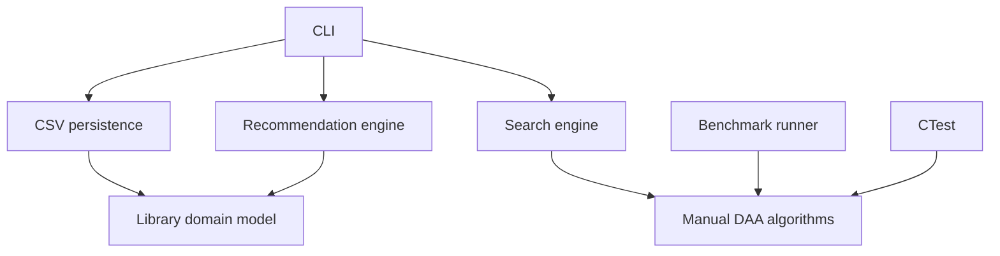

# Architecture

- Domain: typed Book, User, ReadingHistory, CitationEdge, SearchResult records and validated Library storage.
- Algorithms: independent DAA implementations with explicit inputs and outputs.
- Search: catalogue filtering plus selectable string matcher.
- Recommendation: deterministic score with human-readable reasons.
- Persistence: CSV load/export.
- Benchmark: fixed-seed comparison on identical inputs.
- CLI/tests: executable and CTest target.

Search and recommendation hold a const reference to Library, which must outlive them. Catalogue queries are currently linear scans; indexed retrieval is future work.
