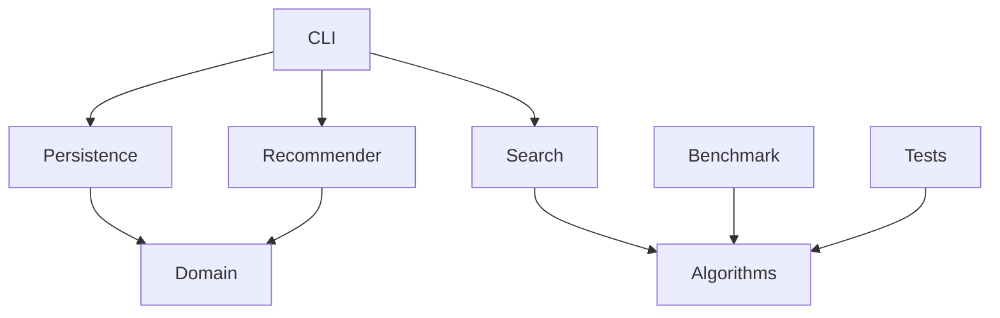

# Architecture

`domain` stores typed books/users. `persistence` loads CSV. `search` executes catalogue filtering and selected matchers. `recommendation` scores unread resources. `algorithms` contains independently callable DAA implementations. `benchmark` writes real Merge/Quick timings. `cli` is the user interface; `tests` is the CTest executable.

